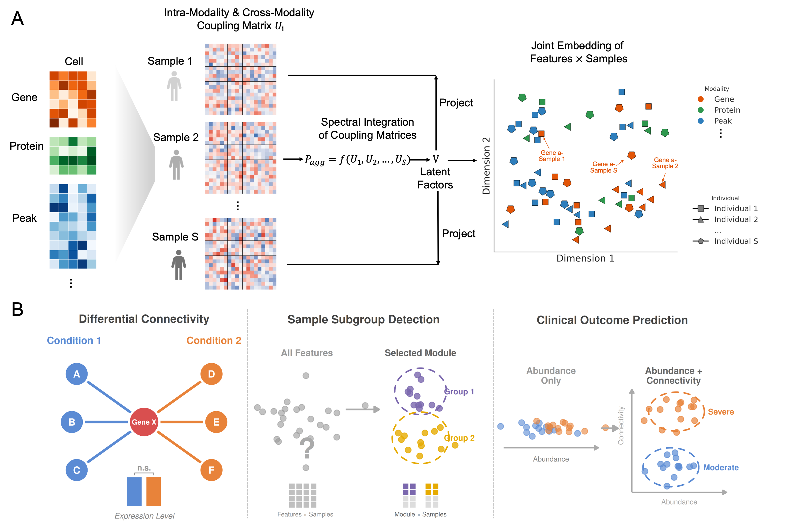

# MOSAIC learns unified feature and sample joint embeddings for population-scale single-cell multi-omics

<p align="center">
  
</p>

MOSAIC (**M**ulti-**O**mic **S**ample-wise **A**nalysis of **I**nter-feature **C**onnectivity) is a spectral framework that learns a high-resolution feature × sample joint embedding from population-scale single-cell multi-omics data. For each individual, MOSAIC constructs a sample-specific coupling matrix capturing all intra- and cross-modality feature-feature associations, then projects all samples into a shared latent space via spectral integration. The resulting embedding represents each feature by its connectivity profile, its pattern of association with all other features, so that connectivity profiles can be compared directly across individuals.

MOSAIC supports three downstream applications:

- **Differential Connectivity (DC) Analysis**: tests for condition-associated shifts in the shared representation of a feature's connectivity profile, using samples as the units of comparison.
- **Unsupervised Subgroup Detection**: groups multi-modal features into coherent modules and tests whether specific modules delineate distinct patient subtypes.
- **Clinical Outcome Prediction**: leverages connectivity-derived features as a complementary signal to abundance-based analysis for improved disease classification.

MOSAIC is run on the cells of one annotated population (e.g. one cell type).

**Documentation**: https://klugerlab.github.io/MOSAIC/

**Paper analyses**: [`reproducibility/`](reproducibility/)

## Installation

```r
# install.packages("devtools")
devtools::install_github("KlugerLab/MOSAIC")
```

## Quick Start

```r
library(MOSAIC)

# --- Run MOSAIC embedding (cells of one annotated population) ---

# One modality (e.g. RNA only)
result <- run_MOSAIC(
  list(RNA = seurat_rna),
  assays = c("RNA"),
  sample_meta = "sample_id",
  condition_meta = "condition"
)

# Two modalities (e.g. RNA + ATAC)
result <- run_MOSAIC(
  list(RNA = seurat_rna, ATAC = seurat_atac),
  assays = c("RNA", "ATAC"),
  sample_meta = "sample_id",
  condition_meta = "condition"
)

# Three modalities (e.g. RNA + ATAC + ADT)
result <- run_MOSAIC(
  list(RNA = seurat_rna, ATAC = seurat_atac, ADT = seurat_adt),
  assays = c("RNA", "ATAC", "ADT"),
  sample_meta = "sample_id",
  condition_meta = "condition"
)

# --- Differential Connectivity Analysis ---
dc <- run_DC_test(result$mosaic_embed_list,
                  groups = result$annotation$Condition)
head(dc$results[order(dc$results$pvalue, -dc$results$F_stat), ])

# Paired design: permute labels within donor
dc <- run_DC_test(result$mosaic_embed_list,
                  groups = result$annotation$Condition,
                  blocks = donor_ids)

# --- Subgroup Detection ---
# Per-feature stratification profiles
sim_list <- compute_feature_similarity(result$mosaic_embed_list)

# Module-level sample similarity
sim_mat <- compute_module_similarity(
  result$mosaic_embed_list,
  feature_idx = which(feature_clusters == module_id)
)

# Test for balanced partition
partition <- find_partition_hclust(as.dist(1 - sim_mat))

# --- Visualization ---
plot_eigen(result$eigenvalues)

plot_mds_cluster(
  sim_list[[1]],
  title = "Feature Embedding",
  cluster = result$annotation$Condition
)
```

## Citation

If you use MOSAIC in your research, please cite:

> Lu, C., Kluger, Y., & Ma, R. MOSAIC learns unified feature and sample joint embeddings for population-scale single-cell multi-omics. Manuscript under review.
